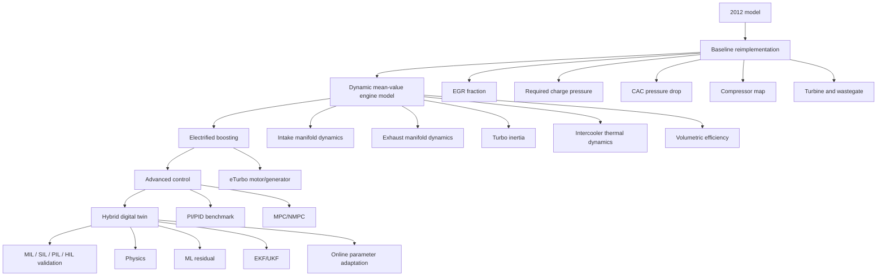

# Real-Time Hybrid Digital Twin and Predictive Control of an Electrified Turbocharged Engine Air Path

## Overview

This project modernizes the architecture of the 2012 Chalmers thesis **"Online modelling and control of a turbo charging system using Simulink"** into a dynamic, control-oriented and data-assisted engine air-path model.

The implementation is intentionally built in layers. Each layer must be validated before the next layer is enabled.

```text
2012 MODEL
    │
    ├── algebraic boost requirement
    ├── static map interpolation
    ├── wastegate turbo
    └── online Simulink execution
    │
    ▼
BASELINE REIMPLEMENTATION
    │
    ├── EGR fraction
    ├── required charge pressure
    ├── CAC pressure-drop map
    ├── compressor map
    └── turbine/wastegate map
    │
    ▼
DYNAMIC MEAN-VALUE ENGINE MODEL
    │
    ├── intake-manifold mass/energy dynamics
    ├── exhaust-manifold mass/energy dynamics
    ├── turbo-shaft inertia
    ├── dynamic intercooler
    └── volumetric-efficiency model
    │
    ▼
ELECTRIFIED BOOSTING
    │
    ├── eTurbo motor/generator torque
    ├── electrical efficiency
    ├── power/torque limits
    └── energy consumption/recovery
    │
    ▼
ADVANCED CONTROL
    │
    ├── PI/PID benchmark
    ├── constrained MPC
    └── optional nonlinear MPC
    │
    ▼
HYBRID DIGITAL TWIN
    │
    ├── physics model
    ├── ML residual correction
    ├── EKF/UKF state estimation
    └── online parameter adaptation
    │
    ▼
VALIDATION AND DEPLOYMENT
    │
    ├── MIL
    ├── SIL
    ├── PIL
    ├── optional HIL
    └── optional FMI/FMU export
```

GitHub can also render the architecture as Mermaid:



## Main objectives

1. Reproduce the essential 2012 quasi-steady turbocharging model.
2. Replace static assumptions with dynamic intake, exhaust, thermal and turbo-shaft states.
3. Add an electrified turbocharger motor/generator.
4. Compare classical control with constrained MPC.
5. Add a machine-learning residual model without replacing the physical model.
6. Add nonlinear state estimation and optional online parameter adaptation.
7. Validate the system from model-in-the-loop through code-generation-based tests and, if hardware is available, HIL.

## Recommended software

Essential:

- MATLAB
- Simulink

Recommended for the full project:

- Control System Toolbox
- Model Predictive Control Toolbox
- Deep Learning Toolbox or Statistics and Machine Learning Toolbox
- Simulink Coder
- Embedded Coder for embedded-oriented code generation
- Simulink Real-Time for real-time/HIL work
- Simulink FMU Builder if standalone FMU export is required

The project can still be developed without all optional toolboxes. Start with the physical model first.

## Repository structure

```text
turbo-digital-twin/
├── README.md
├── LICENSE
├── docs/
│   ├── REPORT_GUIDE.md
│   ├── equations.md
│   ├── model_assumptions.md
│   └── figures/
├── data/
│   ├── raw/
│   ├── compressor/
│   ├── turbine/
│   ├── engine/
│   └── processed/
├── matlab/
│   ├── init_project.m
│   ├── parameters/
│   ├── maps/
│   ├── calibration/
│   ├── metrics/
│   └── plotting/
├── simulink/
│   ├── baseline_2012.slx
│   ├── dynamic_airpath.slx
│   ├── eturbo_airpath.slx
│   ├── closed_loop_control.slx
│   └── digital_twin.slx
├── control/
│   ├── pid/
│   └── mpc/
├── estimation/
│   ├── ekf/
│   └── ukf/
├── ml/
│   ├── prepare_dataset.m
│   ├── train_residual_model.m
│   └── evaluate_residual_model.m
├── tests/
│   ├── baseline/
│   ├── steady_state/
│   ├── transient/
│   ├── controller/
│   └── regression/
└── deployment/
    ├── sil/
    ├── pil/
    ├── hil/
    └── fmu/
```

## Model conventions

Use SI internally:

| Quantity | Unit |
|---|---|
| pressure | Pa |
| temperature | K |
| mass flow | kg/s |
| shaft speed | rad/s internally, rpm only for plots/maps |
| torque | N m |
| power | W |
| volume | m^3 |
| fuel flow | kg/s |
| engine speed | rpm at interface |
| lambda | dimensionless |

Convert all imported data once in preprocessing. Do not scatter unit conversions across the Simulink model.

## Stage 1 — Baseline reimplementation

Top-level model:

```text
Driver/experiment inputs
         |
         v
    EGR fraction
         |
         v
Required air + boost pressure
         |
         v
 CAC pressure loss
         |
         v
 Compressor map
         |
         v
 Turbine map
         |
         v
 Feasibility / wastegate outputs
```

### EGR fraction

A convenient implementation is

```text
x_EGR = (CO2_intake - CO2_air) /
        (CO2_exhaust - CO2_air)
```

with saturation to `[0,1]`.

### Required air flow

```text
m_dot_air_req = lambda_target * AFR_stoich * m_dot_fuel
```

### Baseline cylinder filling

For a four-stroke engine,

```text
V_dot_inducted =
    eta_vol * Vd * engine_speed_rpm / 120
```

The historical baseline can initially use a constant `eta_vol = 0.85`.

Fresh-air volume flow:

```text
V_dot_fresh = V_dot_inducted * (1 - x_EGR)
```

Required density:

```text
rho_req = m_dot_air_req / V_dot_fresh
```

Required manifold pressure:

```text
p_im_req = rho_req * R_air * T_im
```

### Compressor map

Use corrected quantities consistently.

```text
PRc = p_c_out / p_c_in
m_corr = m_dot_c * sqrt(T_c_in/T_ref) / (p_c_in/p_ref)
N_corr = N_tc / sqrt(T_c_in/T_ref)
```

During preprocessing, create lookup surfaces for:

```text
m_corr = f(N_corr, PRc)
eta_c  = f(N_corr, PRc)
```

For a strict recreation of the historical model, invert the map and calculate turbo speed from requested mass flow and pressure ratio. For the dynamic model, switch to the forward form.

### Compressor thermodynamics

```text
T_c_out_s = T_c_in * PRc^((gamma_c-1)/gamma_c)

T_c_out =
    T_c_in +
    (T_c_out_s - T_c_in)/eta_c

P_c = m_dot_c * cp_air * (T_c_out - T_c_in)
```

### Turbine model

```text
ERt = p_t_in / p_t_out

T_t_out_s =
    T_t_in * ERt^(-(gamma_t-1)/gamma_t)

T_t_out =
    T_t_in -
    eta_t*(T_t_in - T_t_out_s)

P_t =
    m_dot_t * cp_exh *
    (T_t_in - T_t_out)
```

### Baseline acceptance tests

The baseline is complete only when:

- the EGR signal stays within physical bounds;
- required boost increases when fuel or lambda target increases;
- the compressor operating point stays inside the usable map;
- turbo speed follows the reference trend;
- turbine expansion ratio follows the reference trend;
- every output has explicit units;
- invalid map operation creates a flag rather than silently extrapolating.

## Stage 2 — Dynamic mean-value engine model

Replace algebraic pressure calculation with dynamic control volumes.

Recommended physical states:

```text
m_im      intake-manifold gas mass
U_im      intake-manifold internal energy
m_em      exhaust-manifold gas mass
U_em      exhaust-manifold internal energy
omega_tc  turbo shaft speed
T_cac     intercooler outlet or wall temperature
```

Recover temperatures and pressures with

```text
T = U/(m*cv)
p = m*R*T/V
```

### Intake manifold

```text
dm_im/dt =
    m_dot_cac +
    m_dot_egr -
    m_dot_eng
```

Energy:

```text
dU_im/dt =
    m_dot_cac*h_cac +
    m_dot_egr*h_egr -
    m_dot_eng*h_im +
    Q_dot_im
```

### Engine flow

Replace the fixed 0.85 filling assumption with a calibration surface:

```text
eta_vol =
    f(engine_speed,
      p_im,
      p_em)
```

A simpler first version can use

```text
eta_vol = f(engine_speed, p_im)
```

Then

```text
m_dot_eng =
    eta_vol *
    p_im*Vd*engine_speed_rpm /
    (120*R_air*T_im)
```

### Exhaust manifold

```text
dm_em/dt =
    m_dot_eng +
    m_dot_fuel -
    m_dot_turb -
    m_dot_wg -
    m_dot_egr
```

Use a corresponding energy balance for `U_em`.

### Turbo shaft

```text
J_tc*d(omega_tc)/dt =
      tau_t
    - tau_c
    - tau_friction
    + tau_electric
```

with

```text
tau_t = P_t/max(omega_tc, omega_min)
tau_c = P_c/max(omega_tc, omega_min)
```

Add lower and upper speed protection.

### Wastegate

Implement a compressible orifice or a calibrated valve flow map. For an orifice model:

```text
r = p_down/p_up
r_critical = (2/(gamma+1))^(gamma/(gamma-1))
```

Use the choked-flow equation below the critical pressure ratio and the subcritical equation above it.

### Intercooler

Start with:

```text
delta_p_cac =
    a0 + a1*m_dot_c + a2*m_dot_c^2
```

and a steady effectiveness relation:

```text
epsilon =
    1 - exp(-UA/(m_dot_c*cp_air))

T_cac_ss =
    T_coolant +
    (T_c_out - T_coolant)*(1-epsilon)
```

Then introduce one thermal state:

```text
tau_cac*dT_cac/dt =
    T_cac_ss - T_cac
```

## Stage 3 — eTurbo

Add motor/generator torque to the shaft equation.

Inputs:

```text
tau_e_cmd
omega_tc
DC bus / battery constraints
```

Limits:

```text
|tau_e| <= tau_max(omega)
|P_e|   <= P_max
omega_tc <= omega_max
```

Mechanical power:

```text
P_e_mech = tau_e * omega_tc
```

When motoring, electrical power is greater than mechanical shaft power because of losses. When generating, recovered electrical power is less than extracted mechanical power.

Log:

- motoring energy;
- regenerated energy;
- peak electric power;
- boost-rise improvement;
- turbo-speed limit activity.

## Stage 4 — Control

Always build a PI/PID benchmark before MPC.

### PI/PID benchmark

Controller error:

```text
e_p = p_boost_ref - p_boost
```

Use wastegate duty as the first manipulated variable. Add eTurbo torque as feedforward/assist only after the wastegate loop works.

### MPC

Recommended manipulated variables:

```text
u =
[ wastegate_position
  EGR_valve_position
  eTurbo_torque ]
```

Recommended outputs:

```text
y =
[ boost_pressure
  EGR_fraction
  lambda_or_airflow ]
```

Recommended constraints include:

```text
omega_tc <= omega_max
boost <= boost_max
surge_margin >= margin_min
tau_e_min <= tau_e <= tau_e_max
0 <= wastegate <= 1
0 <= EGR_valve <= 1
```

A representative objective is

```text
J =
    wp*(p_boost-p_ref)^2
  + wegr*(x_egr-x_egr_ref)^2
  + wdu*Delta(u)^2
  + wpwr*P_electric^2
```

Start with linear MPC at one operating point. If the operating range is too nonlinear, move to gain-scheduled MPC or nonlinear MPC.

## Stage 5 — Hybrid digital twin

Do not replace the physical model with a black box.

Use

```text
prediction =
    physics_prediction +
    ML_residual
```

Example:

```text
eta_c_corrected =
    eta_c_map +
    delta_eta_c_ML
```

or

```text
p_boost_corrected =
    p_boost_physics +
    delta_p_ML
```

Useful ML inputs:

```text
engine_speed
fuel_flow
p_im
p_em
T_im
T_em
omega_tc
wastegate_position
EGR_position
eTurbo_torque
```

Train only after a clean physical baseline exists.

## State estimation

Good estimator states:

```text
m_im
T_im
m_em
T_em
omega_tc
```

Optional augmented calibration states:

```text
k_comp
k_turb
UA_cac
Cd_wg
```

Use an EKF first. Move to UKF if strong nonlinearities or numerical Jacobian sensitivity make the EKF unreliable.

Measurements can include:

```text
p_im
T_im
p_em
T_em
omega_tc
air_mass_flow
```

Always compare measured versus estimated outputs and inspect innovations/residuals.

## Validation matrix

| Test | Baseline | Dynamic | eTurbo | MPC | Twin |
|---|---:|---:|---:|---:|---:|
| steady RPM sweep | yes | yes | yes | yes | yes |
| fuel step | optional | yes | yes | yes | yes |
| boost-reference step | optional | yes | yes | yes | yes |
| EGR step | yes | yes | yes | yes | yes |
| altitude/ambient pressure | no | yes | yes | yes | yes |
| ambient temperature | no | yes | yes | yes | yes |
| map boundary test | yes | yes | yes | yes | yes |
| sensor noise | no | no | no | no | yes |
| parameter mismatch | no | optional | optional | optional | yes |

Report at minimum:

```text
boost RMSE
boost MAE
turbo-speed RMSE
turbine pressure-ratio RMSE
boost rise time
overshoot
settling time
surge-margin violations
electrical energy consumed
electrical energy recovered
controller execution time
estimator RMSE
```

## How to run

Recommended workflow:

```text
1. Run matlab/init_project.m
2. Import or generate processed compressor/turbine maps.
3. Run baseline_2012.slx.
4. Run baseline regression tests.
5. Run dynamic_airpath.slx.
6. Calibrate volumetric efficiency and thermal parameters.
7. Enable eTurbo variant.
8. Tune PI/PID baseline.
9. Initialize MPC/NMPC.
10. Enable EKF/UKF.
11. Train and enable the ML residual model.
12. Run final validation suite.
```

## Development rule

Never add two major features before validating the previous one.

Recommended Git tags:

```text
v0.1-baseline
v0.2-dynamic-manifolds
v0.3-dynamic-turbo
v0.4-eturbo
v0.5-pid
v0.6-mpc
v0.7-estimator
v0.8-hybrid-ml
v1.0-validated
```

## References

Primary historical basis:

- Jacob Heimersson and Adam Johannesson, *Online modelling and control of a turbo charging system using Simulink*, Chalmers University of Technology, 2012.

Current MATLAB/Simulink implementation references:

- MathWorks Model Predictive Control Toolbox documentation
- MathWorks MPC Controller and Nonlinear MPC Controller documentation
- MathWorks Extended Kalman Filter and Unscented Kalman Filter documentation
- MathWorks Simulink Real-Time documentation
- MathWorks FMU export documentation

## License

Choose a license that is compatible with your data and any third-party turbocharger maps. Do not redistribute manufacturer map data unless you have permission.
